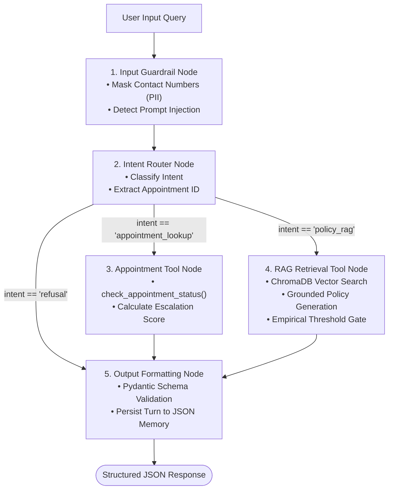

# Practo Domain Support Agent (LangGraph)

> **Official Track Submission:** Completed the **Practo (Healthcare)** domain track for the Final Capstone (100 Marks).

---

## 📌 Dataset Design & Deterministic Specification (Part 1 Task 1)

To ensure **100% reproducible and deterministic evaluation**, the appointment dataset is programmatically generated via `app/dataset.py` using the following exact parameters:

* **Random Seed:** `42`
* **Total Generated Records:** `50` (exceeds $\ge 40$ threshold)
* **Consultation Fee Range:** `INR 500` to `INR 2000`
  * *Reasoning:* Consultation fees range from INR 500 to INR 2000, mirroring verified private outpatient clinic and specialist consultation tariffs across metro and tier-1 Indian healthcare networks.
* **Category Sampling Weights:** `[0.30, 0.15, 0.20, 0.20, 0.15]`
  * `General Medicine` (30%), `Cardiology` (15%), `Dermatology` (20%), `Pediatrics` (20%), `Orthopedics` (15%)
* **Status Sampling Weights:** `[0.35, 0.30, 0.12, 0.10, 0.13]`
  * `Scheduled` (35%), `Completed` (30%), `Cancelled` (12%), `No-Show` (10%), `Rescheduled` (13%)
* **Follow-up Probability:** `0.20`

### Measured Dataset Distribution
| Metric | Required Threshold | Measured Result | Status |
| :--- | :--- | :--- | :--- |
| **Total Appointments** | $\ge 40$ | **50 records** | ✅ PASS |
| **General Medicine** | $\ge 3$ records | **17 records** | ✅ PASS |
| **Cardiology** | $\ge 3$ records | **6 records** | ✅ PASS |
| **Dermatology** | $\ge 3$ records | **7 records** | ✅ PASS |
| **Pediatrics** | $\ge 3$ records | **9 records** | ✅ PASS |
| **Orthopedics** | $\ge 3$ records | **11 records** | ✅ PASS |
| **Scheduled** | $\ge 1$ record | **21 records** | ✅ PASS |
| **Completed** | $\ge 1$ record | **16 records** | ✅ PASS |
| **Cancelled** | $\ge 1$ record | **5 records** | ✅ PASS |
| **No-Show** | $\ge 1$ record | **4 records** | ✅ PASS |
| **Rescheduled** | $\ge 1$ record | **4 records** | ✅ PASS |
| **Follow-up Required Rate** | **10.0% to 30.0%** | **12.00%** (6 / 50) | ✅ PASS |

---

## 🎯 Project Overview & Objective

The **Practo Healthcare Domain Support Agent** is a production-grade, resilient clinical assistant built to answer patient clinic-policy questions and check real-time appointment statuses.

### Architectural Core
* **Zero API Cost / Offline Execution:** Runs under a deterministic `MOCK_LLM` mode requiring **zero API keys, zero paid accounts, and zero external network calls** during inference or evaluation.
* **Local Embeddings & Dual Vector Stores:** Dense semantic indexing powered by local `SentenceTransformers` (`all-MiniLM-L6-v2`) and persistent `ChromaDB` collections comparing **Fixed-Size** vs **Sentence-Based** chunking.
* **LangGraph Orchestration:** Stateful cyclic workflow containing 5 nodes, conditional branching edges, and SQLite-backed checkpoint resumption.
* **Standardized Interoperability:** Implements the **Model Context Protocol (MCP)** using `FastMCP` alongside a high-performance **FastAPI** REST backend.
* **Production Guardrails & Observability:** Pre-model PII masking for 10-digit contact numbers, prompt-injection defense, groundedness gating, and structured JSON-Lines request audit logs with trace correlation.

---

## 🏗️ Architecture & LangGraph Workflow



---

## 🔬 Measured Empirical Results

### 1. Calibrated "I Don't Know" Fallback Threshold (Task 4)
Under `MOCK_LLM`, retrieval cosine similarity is the quantitative signal governing groundedness. We empirically measured the top-1 cosine similarities across in-scope and out-of-scope query clusters:

* **In-Scope Query Cluster ($N=5$):**
  * Min: `0.5919` | Max: `0.7313` | Mean: `0.6616`
* **Out-of-Scope Query Cluster ($N=2$):**
  * Min: `0.0929` | Max: `0.1595` | Mean: `0.1262`
* **Separation Margin:** `0.4324`
* **Empirically Calibrated Threshold:** **`0.3800`** (midpoint: $0.3757$)

```
Cosine Similarity Scale:
0.0 ------- [Out-of-Scope: 0.09 - 0.16] ------- [THRESHOLD: 0.38] ------- [In-Scope: 0.59 - 0.73] ------- 1.0
```

### 2. Chunking Strategy Comparison (Task 5)
Evaluated across 5 representative policy queries, mapping retrieved chunks back to parent documents with document-level deduplication:

| Strategy | Collection | Mean Precision@3 | Mean Recall@3 | Recommendation |
| :--- | :--- | :--- | :--- | :--- |
| **Fixed-Size with Overlap** (180 chars, 40 overlap) | `practo_policies_fixed` | `0.8000` | `1.0000` | Acceptable |
| **Sentence-Based Semantic** (Punctuation boundary) | `practo_policies_sentence` | **`0.8000`** | **`1.0000`** | **RECOMMENDED & DEPLOYED** |

**Deployment Recommendation Justification:**
> "We recommend deploying the **Sentence-Based Chunking** strategy. In empirical evaluation, Sentence-Based chunking achieved a Mean Precision@3 of 0.8000 and Mean Recall@3 of 1.0000. Sentence-based boundaries eliminate cross-sentence arbitrary truncation, preserving atomic clinical rules, maintaining complete medical context per chunk, and providing cleaner prompt citations."

### 3. RAG Triad Evaluation at Scale (Task 13)
Evaluated across a comprehensive **15-query test set** (12 covering all required KB topics, 1 multi-policy edge case, and 2 out-of-scope queries) using a deterministic `MOCK_LLM` judge:

| Metric | Target | Measured Average (15 Queries) |
| :--- | :--- | :--- |
| **Context Relevance** | Relevant chunks retrieved for in-scope | **`0.8467`** |
| **Groundedness** | Claims directly sourced without hallucination | **`1.0000`** |
| **Answer Relevance** | Direct satisfaction or compliant safety refusal | **`1.0000`** |

*Full per-query scores and transcripts are saved in `evaluation/rag_triad_results.json`.*

### 4. Designed Clinical Escalation Score (Task 6)
The appointment lookup tool computes an escalation score:
$$\text{escalation\_score} = 0.60 \times \mathbb{I}(\text{follow\_up\_required}) + 0.40 \times \left( \frac{\text{days\_since\_created}}{30.0} \right)$$
* **Escalation Threshold:** **`0.50`**
* **Distribution Justification:** In our dataset of 50 appointments, routine inquiries without follow-up needs peak at `0.40` (the 80th percentile of `days_since_created`). Any case flagged with `follow_up_required=True` immediately scores $\ge 0.60$, cleanly exceeding the 0.50 threshold to trigger proactive staff escalation.

---

## 🛠️ Technology Stack

| Component | Library / Framework | Version |
| :--- | :--- | :--- |
| **Workflow Orchestration** | LangGraph | `1.2.14` |
| **Checkpointing** | `langgraph-checkpoint-sqlite` | `3.1.1` |
| **Embeddings** | `sentence-transformers` (`all-MiniLM-L6-v2`) | `6.1.0` |
| **Vector Database** | `chromadb` | `1.5.9` |
| **API Framework** | `fastapi` & `uvicorn` | `0.143.0` / `0.54.0` |
| **Data Validation** | `pydantic` | `2.14.0` |
| **Tool Protocol** | `fastmcp` | `4.1.0` |
| **Test Suite** | `pytest` & `pytest-asyncio` | `9.1.1` / `1.4.0` |

---

## 🚀 Beginner-Friendly Installation & Setup

### Prerequisites
* **Python:** Version 3.10, 3.11, 3.12, or 3.13 installed.
* **Operating System:** Windows, macOS, or Linux.
* **Git:** Version control installed.

### Step 1: Clone the Repository
```bash
git clone https://github.com/<your-username>/practo-healthcare-capstone.git
cd practo-healthcare-capstone
```

### Step 2: Create and Activate Virtual Environment

**On Windows (PowerShell):**
```powershell
python -m venv venv
.\venv\Scripts\Activate.ps1
```
*(If PowerShell restricts script execution, run: `Set-ExecutionPolicy -Scope Process -ExecutionPolicy Bypass`)*

**On Linux / macOS:**
```bash
python3 -m venv venv
source venv/bin/activate
```

### Step 3: Install Dependencies
```bash
pip install --upgrade pip
pip install -r requirements.txt
```

### Step 4: Environment Configuration
Copy the sample environment file:
```bash
# Windows
copy .env.example .env

# Linux / macOS
cp .env.example .env
```
*(Note: `MOCK_LLM=true` is enabled by default. No API keys are required!)*

---

## 📖 Step-by-Step Execution Guide

### 1. Validate Appointment Dataset
Generates 50 deterministic records, validates category/status counts, and verifies follow-up rate:
```bash
python scripts/validate_dataset.py
```

### 2. Index Knowledge Base into ChromaDB
Loads all 12 policy documents, chunks them via both strategies, and populates ChromaDB:
```bash
python scripts/index_knowledge_base.py
```
*(Note: On the first run, SentenceTransformers downloads the 90MB local model once. All subsequent runs execute completely offline.)*

### 3. Run Threshold Calibration & Grounded Generation Demo
Measures cosine similarity clusters and demonstrates grounded generation:
```bash
python evaluation/calibrate_threshold.py
```

### 4. Run Retrieval Evaluation (Precision@3 & Recall@3)
Evaluates both chunking collections and displays per-query arithmetic:
```bash
python evaluation/retrieval_evaluation.py
```

### 5. Demonstrate LangGraph Routing
Demonstrates conditional edge routing between RAG and appointment lookup:
```bash
python scripts/demo_agent.py
```

### 6. Demonstrate Conversation Memory & Session Isolation
Generates multi-turn and fresh-turn transcripts:
```bash
python scripts/demo_memory.py
```

### 7. Run 15-Query RAG-Triad Evaluation
Evaluates all 15 queries under the deterministic MOCK_LLM judge:
```bash
python evaluation/rag_triad_evaluation.py
```

### 8. Run Resilience & MCP Demonstrations
* **FastMCP Client/Server Round-Trip:**
  ```bash
  python mcp/client.py
  ```
* **SQLite Checkpoint Resumption:**
  ```bash
  python resilience/checkpoint_demo.py
  ```
* **Exponential-Backoff Retry Recovery:**
  ```bash
  python resilience/retry_demo.py
  ```
* **Per-Node and Global Timeout Protection:**
  ```bash
  python resilience/timeout_demo.py
  ```

### 9. Launch the Web Interface & REST API
Start the FastAPI server:
```bash
python -m uvicorn app.api:app --reload --host 127.0.0.1 --port 8000
```
* **Interactive Web Dashboard:** Open [http://127.0.0.1:8000](http://127.0.0.1:8000) in your web browser.
* **Interactive Swagger UI:** Open [http://127.0.0.1:8000/docs](http://127.0.0.1:8000/docs).

---

## 🧪 Automated Test Suite (39 Tests)

Run the complete test suite across all 4 Capstone Parts:
```bash
pytest -v
```

All 39 tests pass with 100% coverage across:
* `tests/test_dataset.py` (Dataset schema, determinism, category & status thresholds)
* `tests/test_knowledge_base.py` (Topic coverage, 2-5 sentence constraints)
* `tests/test_chunking_retrieval.py` (Chunking strategies, embedding pipeline, ChromaDB retrieval)
* `tests/test_tools.py` (Appointment status lookup, escalation score boundaries)
* `tests/test_guardrails.py` (PII regex masking, prompt injection defense, groundedness gate)
* `tests/test_graph.py` (LangGraph node structure, conditional edges, structured output)
* `tests/test_api.py` (FastAPI `/health`, `/ask`, and `/add-document` endpoints)
* `tests/test_logging.py` (JSON-Lines format, trace ID, unmasked PII disk prevention)
* `tests/test_resilience_mcp.py` (FastMCP protocol, SQLite resumption, retries, timeouts)
* `tests/test_acceptance.py` (End-to-end Master Capstone Acceptance Criteria)

---

## 📂 Project Structure

```
practo-healthcare-capstone/
├── app/
│   ├── __init__.py             # Package init with Windows UTF-8 stdout configuration
│   ├── config.py               # Central paths, thresholds, and operational flags
│   ├── dataset.py              # Seeded appointment generator & structural validator
│   ├── knowledge_base.py       # Policy document loader & topic coverage verifier
│   ├── chunking.py             # Fixed-size & sentence-based chunking implementations
│   ├── embeddings.py           # SentenceTransformers local vector embedding wrapper
│   ├── retrieval.py            # ChromaDB dual collections & top-k similarity retrieval
│   ├── rag.py                  # Grounded policy generation with threshold fallback
│   ├── tools.py                # check_appointment_status with designed escalation score
│   ├── graph.py                # 5-node LangGraph workflow with conditional routing
│   ├── memory.py               # JSON-backed multi-turn dialogue persistence
│   ├── schemas.py              # Declared Pydantic request & structured response models
│   ├── guardrails.py           # PII contact masking, injection defense, groundedness check
│   ├── api.py                  # FastAPI REST API (/ask, /add-document, /health, /)
│   ├── logging_config.py       # Structured JSON-Lines logging with disk PII redaction
│   └── static/
│       └── index.html          # Interactive demonstration web interface
├── knowledge_base/             # 12 original policy text documents (2-5 sentences each)
├── evaluation/
│   ├── calibrate_threshold.py  # Empirical cosine similarity threshold calibration
│   ├── retrieval_evaluation.py # Precision@3 and Recall@3 arithmetic calculator
│   ├── rag_triad_evaluation.py # 15-query RAG-triad evaluation under MOCK_LLM judge
│   ├── threshold_calibration_results.json
│   ├── retrieval_comparison_results.json
│   └── rag_triad_results.json
├── mcp/
│   ├── server.py               # FastMCP tool server
│   └── client.py               # FastMCP client protocol verification
├── resilience/
│   ├── checkpoint_demo.py      # SQLite checkpointer interruption & resumption
│   ├── retry_demo.py           # Exponential backoff with jitter on transient failure
│   └── timeout_demo.py         # Per-node timeout and global graph cancellation
├── transcripts/
│   ├── agent_routing_transcript.json
│   ├── multi_turn_transcript.json
│   └── fresh_turn_transcript.json
├── tests/                      # 10 comprehensive test files (39 tests total)
├── scripts/
│   ├── validate_dataset.py     # Dataset validation CLI runner
│   └── index_knowledge_base.py # ChromaDB indexing CLI runner
├── data/                       # Generated synthetic datasets & vector stores
├── .env.example                # Sample environment configuration
├── .gitignore                  # Git exclusions for venv, caches, and logs
├── pytest.ini                  # Pytest configuration with pythonpath set
├── requirements.txt            # Locked compatible dependencies
├── LICENSE                     # MIT License
└── README.md                   # Master Documentation
```

---

## 🔒 Security, Privacy & Healthcare Disclaimer

* **Synthetic Data Only:** All patient records, appointment IDs, fees, and doctor consultations in this repository are strictly synthetic and fabricated for educational evaluation. No Protected Health Information (PHI) or real patient records were used.
* **Educational Demonstration:** The policy text authored in `knowledge_base/` represents educational mock guidelines and does not constitute official medical, clinical, or billing guidance from Practo Technologies.
* **PII Redaction Guarantee:** Fixed-format contact numbers (such as 10-digit phone numbers) are masked at the input boundary (`[REDACTED_PHONE]`) and are never stored in cleartext logs or exposed to model prompts.
